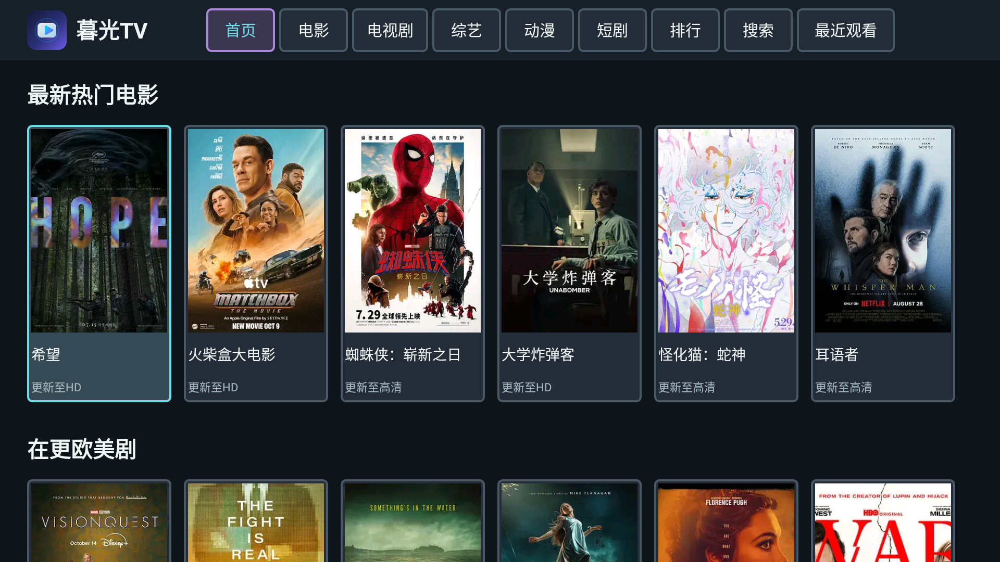
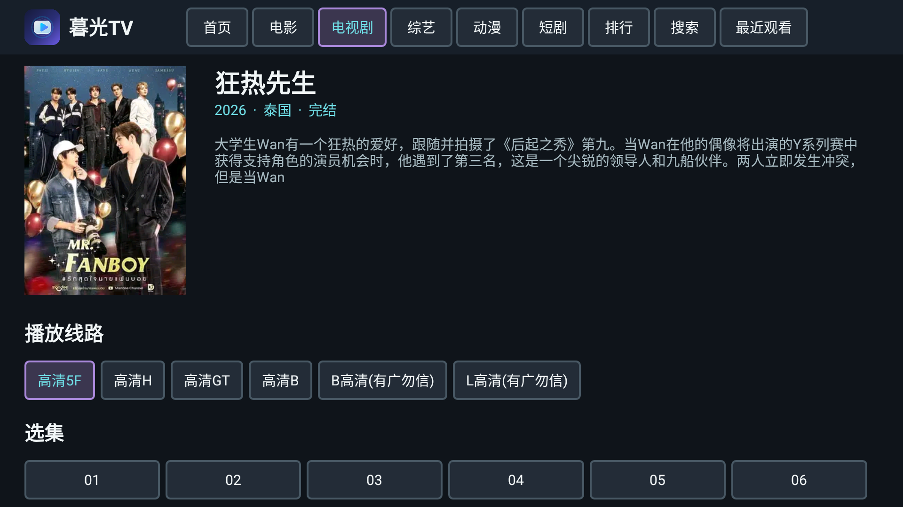

# 暮光TV / Screenlight TV

## 界面预览

**首页**



**电视剧筛选**


**剧集详情与选集**



面向 Android 4.4.2 及以上电视盒子的 32 位构建工程，当前版本 1.9.1。`src` 是电视界面、接口和播放器的 Java 源码；`apktool` 保留原电视包的资源、旧播放器及 ARMv7 原生库；`screenlight-icon.svg` 是应用图标原稿。应用标识为 `com.screenlight.tv`。由于应用标识已变更，安装 1.9.1 不会覆盖此前版本，也不会自动迁移其播放记录。播放时按向下键打开控制与选集面板，可暂停或继续播放、切换上一集或下一集，并切换线路、倍速和画面比例；左右方向键快进或后退时显示进度条。画面模式包括原比例居中、等比铺满和拉伸全屏，默认等比铺满。

电视界面使用横向海报网格和明确的遥控器焦点。海报列数、图片高度及顶部导航随显示空间调整；详情页多集选集按六列铺排。分类页保留排序、类型、地区、语言、年份筛选，另有排行、搜索和最近观看。

## 版本更新记录

### 1.9.1

- 从顶部导航进入分类页时默认选择“最热”排序；搜索框右侧依次为“搜索”“清除”。
- 按影片保存正在观看的集数、播放位置和实际可播放的线路；重新进入详情页时提供续播入口。
- 将电视界面和播放器放入主 DEX，修复 Android 4.4.2 无法加载第二个 DEX 导致的启动问题，并为旧系统所缺少的界面 API 加入版本判断。
- 修复 Android 4.4.2 对详情响应的 AES-GCM 解密；为旧系统 HTTPS 线路启用 TLS 1.2，并补充公开 CA 根证书（包括 Let's Encrypt Root YR）。
- 更换应用标识和源码命名空间为 `com.screenlight.tv`。

### 1.9

- 上线横屏电视界面、遥控器焦点导航、分类筛选、排行、搜索和最近观看。
- 增加选集、线路切换、倍速、画面比例、播放进度及播放失败后的线路回退。
- 更新暮光TV的名称、图标和 Android TV 横幅。

## 构建

需要 JDK、Android SDK Platform 28、Build Tools 35.0.0 和 Python 3。`tools/apktool.jar` 包含在工程内。公开仓库不包含 release 签名文件和服务访问密钥。开发者需要自行提供有权使用的客户端资源与签名文件；缺少客户端资源时，服务发现和部分接口可能无法工作。可通过 `-Keystore` 参数指定自己的签名文件，并把脚本中的 `--ks-key-alias` 改成相应别名。签名口令由工程持有人通过环境变量或本地 `signing/release-password.txt` 提供，不写入仓库。

```powershell
python -m pip install cairosvg pillow
python .\render_assets.py
$env:SCREENLIGHT_STORE_PASS = '<release-key-password>'
.\build_release.ps1 -AndroidSdk 'C:\path\to\android-sdk'
```

`render_assets.py` 会从 SVG 生成应用图标和 Android TV 启动横幅。构建脚本编译 Java、与原包代码合并为单个主 DEX、重建 APK、对齐、签名并验证。修改版本号时同步编辑 `apktool/apktool.yml` 和 APK 输出名称。

旧系统 HTTPS 兼容使用 certifi 2026.07.22 的 Mozilla CA 集（许可文本见 `apktool/assets/mozilla-ca-bundle-LICENSE.txt`），以及 Let's Encrypt 官方发布的 Root YR 证书。后续维护时需更新 CA 集，并继续保留证书校验。

已在 Android 9 模拟器验证分类、详情及续播；在 Android 4.4.2 x86 模拟器验证启动、海报、详情、搜索界面和 HTTPS 视频请求。Android 4.4.2 x86 模拟器的解码器在播放测试视频时返回 `MediaCodec` 错误，因此真实 ARM 电视盒子的播放效果仍需设备验证。部分上游线路也可能返回 HTTP 451 或暂时不可用。

## 范围

此工程是对原 TV APK 的可维护重建，不是原厂完整源码。它保留原包内第三方资源和库。服务端、播放线路及上游视频流不在工程内，运行时仍依赖原服务。公开发布不代表取得原包资源、视频内容或第三方库的再授权；使用和再分发前应核实相应权利。不要上传本地工程压缩包，其中含有签名文件。

手机端的服务发现入口会返回四个 API 地址。`TvApi` 在启动时读取加密配置，缓存解出的地址，并在所有地址请求失败后再次获取配置；离线时使用上次缓存和内置地址。手机端 `version` 接口用于更新手机 APK，不适合直接安装到电视端。
