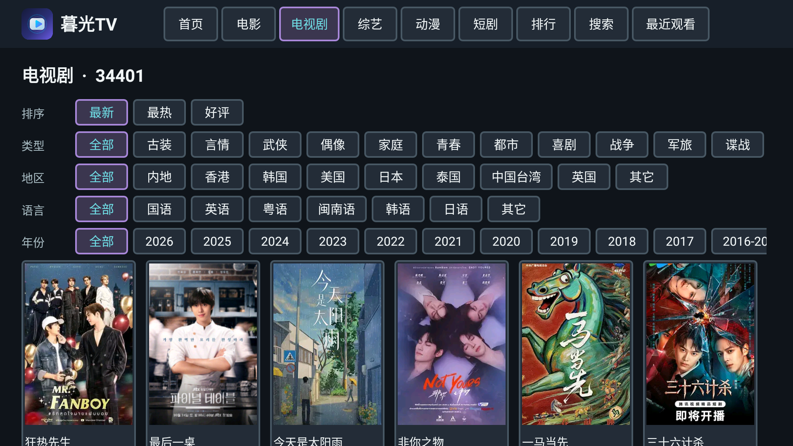

# 暮光TV / Screenlight TV

## 界面预览

**首页**


**电视剧筛选**



**剧集详情与选集**


Android 9 电视盒子专用的 32 位构建工程，当前版本 1.9。`src` 是电视界面、接口和播放器的 Java 源码；`apktool` 保留原 TV 包的资源、旧播放器及 ARMv7 原生库；`screenlight-icon.svg` 是应用图标原稿。应用标识沿用 `com.tg666.a`，以便覆盖安装此前版本。播放时按向下键打开控制与选集面板，可暂停或继续播放、切换上一集或下一集，并切换线路、倍速和画面比例；左右方向键快进或后退时显示进度条。画面模式包括原比例居中、等比铺满和拉伸全屏，默认等比铺满。

电视界面使用横向海报网格和明确的遥控器焦点。海报列数、图片高度及顶部导航随显示空间调整；详情页多集选集按六列铺排。分类页保留排序、类型、地区、语言、年份筛选，另有排行、搜索和最近观看。

## 构建

需要 JDK、Android SDK Platform 28、Build Tools 35.0.0 和 Python 3。`tools/apktool.jar` 包含在工程内。公开仓库不包含 release 签名文件和 `apktool/assets/tg_client_key.pk8`。开发者需要自行提供有权使用的客户端资源与签名文件；缺少客户端资源时，服务发现和部分接口可能无法工作。可通过 `-Keystore` 参数指定自己的签名文件，并把脚本中的 `--ks-key-alias` 改成相应别名。签名口令由工程持有人通过环境变量提供，不写在源码中。

```powershell
python -m pip install cairosvg pillow
python .\render_assets.py
$env:SCREENLIGHT_STORE_PASS = '<release-key-password>'
.\build_release.ps1 -AndroidSdk 'C:\path\to\android-sdk'
```

`render_assets.py` 会从 SVG 生成应用图标和 Android TV 启动横幅。构建脚本编译 Java、生成 `classes2.dex`、重建 APK、对齐、签名并验证。修改版本号时同步编辑 `apktool/apktool.yml` 和 APK 输出名称。

## 范围

此工程是对原 TV APK 的可维护重建，不是原厂完整源码。它保留原包内第三方资源和库。服务端、播放线路及上游视频流不在工程内，运行时仍依赖原服务。公开发布不代表取得原包资源、视频内容或第三方库的再授权；使用和再分发前应核实相应权利。不要上传本地工程压缩包，其中含有签名文件。

手机端的 `tg4.json` 服务发现入口会返回四个 API 地址。`TvApi` 在启动时读取加密配置，缓存解出的地址，并在所有地址请求失败后再次获取配置；离线时使用上次缓存和内置地址。手机端 `version` 接口用于更新手机 APK，不适合直接安装到电视端。
